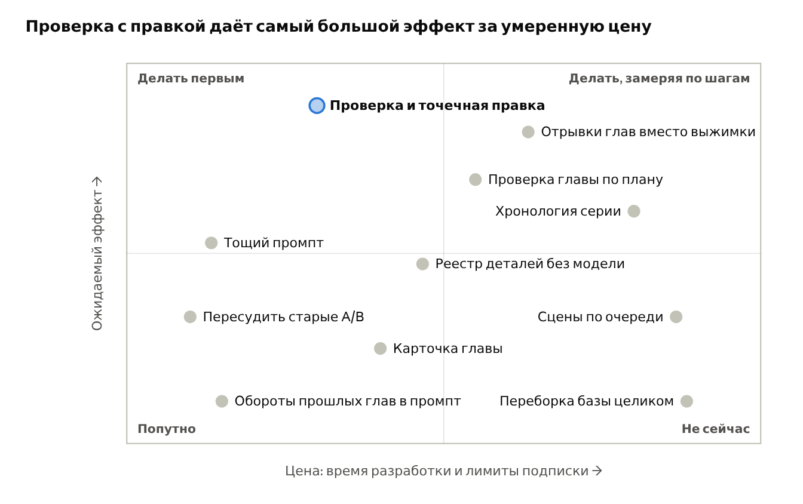
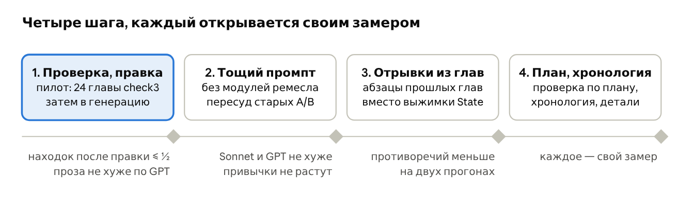

# Усиление движка: мозговой штурм

2026-10-15. Рабочая версия — Claude Docs (https://claude.ai/code/artifact/e3fb1791-4336-48b6-92e0-ce582b2bc8b5); этот файл — копия для git. Цифры — из `AUDIT_UNIFIED.md` и `bench/`, по одному прогону на замер, если не сказано иначе.

## Что движок даёт сейчас

Доказанная польза движка — в серии глав: память, реестр имён, проверка непрерывности, проверка второй линии. Правила ремесла в промпте помогали только GLM; у Kimi, DeepSeek, Sonnet и GPT разницы нет.

| Блок движка | Как мерили | Результат | Вердикт |
| --- | --- | --- | --- |
| Весь блок правил (ремесло, антиклише, контракт жанра, META_RULES) | Главы с блоком против глав без него, судьи попарно и по шкале | GLM +0.29 к прозе (03.10); Kimi +0.06 ± 0.16 и DeepSeek −0.02 ± 0.10 без блока (06.10); Sonnet: 0 устойчивых голосов из 16 у Kimi и DeepSeek (14.10), GPT-судья 4 : 3 (15.10) | Помогает только GLM. Сильным моделям — ни пользы, ни вреда |
| Антиклише | Абляция на GLM, счётчик сравнений | +0.16 к прозе, сравнений −40 % | Работает на GLM; на остальных не проверено отдельно |
| Модули ремесла (6 из 11 тыс. символов блока) | 16 пар, GLM; QUICK без модулей на панели (11.10) | −0.05 ± 0.07; без модулей привычки сильнее: сравнений у DeepSeek 2.85 → 3.70 на 1000 слов | Эффекта на оценку нет; держат привычки моделей в узде |
| Базовые правила META_RULES | Абляция, 8 пар | −0.15, почти весь сдвиг у одного судьи | Слабый сигнал |
| Режим QUALITY против QUICK | Пары, те же задачи | Разницы нет | Лишний расход |
| Память серии (State, L3, анализ главы) | Серии по 4 главы, противоречия парой цитат (11.10) | 2.25 ± 0.62 противоречия на серию против 4.75 ± 1.35 без памяти, t ≈ 2.4 | Работает: противоречий вдвое меньше |
| Детали серии в State | Серии DeepSeek, два прохода судей (11.10) | 3.57 → 2.64 на серию, −0.92 ± 0.95; Sonnet-судья разницы не видит | В пределах шума; этаж, одежда, вещи всё равно меняются |
| Реестр имён с отчествами | Детектив × 4 серии, DeepSeek (12.10) | 0 смен при 233 упоминаниях против 10 при 136 | Работает, без модели и без State |
| Проверка главы по трём прошлым (`cross_check_signals`) | 24 главы, находки размечают Kimi и Opus (14–15.10) | GPT-6.1 Sol: 84 % находок настоящие, полнота 42 из 68; Sonnet 70 %, 43 из 63; DeepSeek 30 % | Работает с Sol; подключена 15.10, пока только как сигнал автору |
| Проверка второй линии | Пары «живая / проваленная» по 7 семействам (13.10) | Надёжны романтика, триллер, хоррор: ложный отказ 1 из 48 живых глав | Работает для трёх семейств |
| Голоса, пресеты, стили | Угадывание голоса, признаки манеры | Меняют манеру, если в них конкретные приёмы; на оценку качества не влияют | Делают то, что должны |
| Сигналы по тексту | p90 по 64 главам трёх моделей | Сигнал у 27 из 64 глав, у каждой модели своя привычка | Работает как подсказка автору |
| Повторы между главами | 16 серий по 3 главы | Оборот во всех трёх главах — у 5 серий из 16 | Сигнал есть, лечения нет |

Писатели и судьи на 15.10: Sonnet 5.5 и GPT-6.1 Sol пишут лучше DeepSeek (у GPT 11 устойчивых голосов из 11 против DeepSeek), между собой почти вровень. Kimi и DeepSeek как судьи выбирают позицию, а не текст: первая позиция выигрывает 30–35 голосов из 48. GPT-6.1 Sol устойчив к порядку во всех 8 парах и к длине главы равнодушен — единственный судья, которому можно верить на близких текстах.

## Диагноз

Правила ремесла не помогают сильной модели, потому что она их уже знает. Блок движка в QUICK — 12–16 тыс. символов общих советов: ритм, диалог, антиклише, контракт жанра. GLM это подтягивало (+0.29), потому что GLM слабее; Sonnet и GPT пишут на том же уровне с ними и без них.

Три вещи сильная модель не может сделать сама, и именно там движок даёт измеримый эффект:

1. **Помнить свою историю.** Каждый вызов — с чистого листа; без State и L3 противоречий вдвое больше. Но выжимка держит сюжет, а не детали: этаж, шарф, изъятый плащ меняются и при полном State.
2. **Видеть свои ошибки.** Модель не замечает смену отчества, повтор оборота в трёх главах подряд, свою привычку к сравнениям. Реестр имён и сигналы по тексту — без модели и потому работают на любом генераторе.
3. **Держать замысел автора.** Вторая линия, тон, стиль серии меняют текст только когда в них конкретные приёмы, а не общие формулы; провал линии ловится по конкретным вопросам о ремесле линии, а не оценкой «второй жанр 0–10».

Общий вывод: движок силён как **память, контроль и носитель замысла**, и слаб как **учебник ремесла**. Вторая причина, почему «не видно пользы», — измерительная: до 15.10 судьи выбирали позицию, и разница меньше «заметной» была неизмерима. Часть старых «эффекта нет» может оказаться «эффект не был виден».

## Принцип усиления

Движок должен давать модели то, чего она знать не может, и проверять то, чего она за собой не видит. Всё, что модель знает сама (как писать диалог, что такое детектив), в промпте — балласт: место занимает, главу не меняет.

Четыре правила отбора для любой новой идеи:

- **Факты истории важнее правил ремесла.** Цитата из главы 3, где плащ изъяли, полезнее абзаца о ритме сцены.
- **Проверка сильнее инструкции.** «Не меняй этаж» в промпте не сработало; «в главе 2 был третий этаж, в главе 4 пятый» после генерации — конкретно и проверяемо.
- **Без модели — где только можно.** Реестр имён и сигналы по тексту стоят ноль, не зависят от генератора и не ломаются, когда анализ главы сорвался.
- **Не под одну модель.** Изменение принимается, если не вредит ни Sonnet, ни GPT, ни DeepSeek и помогает хотя бы одному (правило панели от 06.10).

И одно правило о цене: у проверки есть стоимость в лимитах подписки (проверка Sol — около 1 % окна на главу, судейство пары — около 1 %), и каждый новый вызов должен окупаться измеримой разницей, а не ощущением надёжности.

## Мозговой штурм

Одиннадцать идей; каждая даёт модели то, чего она не знает, или проверяет то, чего не видит. У каждой — способ замера и то, что для неё уже построено.

| Группа | Идея | Что даёт модели | Как замерить | Что уже есть |
| --- | --- | --- | --- | --- |
| После генерации | **Проверка и точечная правка** | Sol находит противоречия парой цитат; писатель правит только эти места; Sol проверяет снова | Пилот на 24 главах `check3`: сколько находок ушло после правки; судья GPT «до / после» — не испортилась ли проза | `cross_check_signals`, 116 размеченных находок, судья GPT |
| До генерации | **Отрывки глав вместо выжимки** | По плану главы ищутся места прошлых глав, где были её вещи, люди, адреса; в промпт идут сами абзацы, а не State | Серии по 4 главы: противоречия по Sol, разметка Kimi и Opus; против памяти как есть | `previous_chapters`, реестр имён, план главы |
| До генерации | **Тощий промпт для сильных писателей** | Без модулей ремесла (6 из 12–16 тыс. символов); остаются антиклише, контракт, память; место — под контекст истории | Sonnet и GPT: тощий против полного, судья GPT (для глав GPT — Kimi), устойчивые голоса; привычки счётчиком | `--without`, замер 11.10 на DeepSeek и Kimi |
| До генерации | **Реестр деталей без модели** | Как реестр имён: этаж, числа, время, цвет вещей из текста глав — «пиши ровно так» | Повторить серии 12.10, считать противоречия деталей | `series_names`, `text_signals` |
| До генерации | **Хронология серии** | День и время каждой сцены разделом State; время и даты — около 10 из 40 оставшихся противоречий | Те же серии, счёт противоречий времени | анализ главы |
| План | **Проверка главы по плану** | Sol сверяет главу с планом: что пропущено, что раскрыто раньше срока; пропущенное дописывается | Главы с планом: доля пунктов выполнена; судья GPT «до / после» | планировщик, `series --plan` |
| План | Сцены по очереди | Длинная глава пишется сценами с проверкой между ними | Дорого в вызовах; только после проверки по плану | — |
| После генерации | Обороты прошлых глав в промпт | Список оборотов и зачинов прошлых глав «не повторяй» — без модели | `series_signals` до и после на 16 сериях | `series_signals` |
| Автору | Карточка главы | Все сигналы с цитатами и кнопкой «поправить это место» | Не замер модели, а удобство: без неё проверка не используется | `warning` в `run_generation` |
| Замеры | Пересудить старые A/B | Старые «эффект не виден» (тона, пресеты, модули) — через устойчивого судью GPT | 16 вызовов на замер, около 8 % окна | главы в `bench/` |
| База | Переборка базы целиком | Переписать модули ремесла заново | A/B на Sonnet и GPT, судья GPT | — (см. раздел ниже) |

*Оценка по замерам `AUDIT_UNIFIED.md`; положение на схеме — экспертная оценка, не замер.*

В верхней половине — то, что закрывает доказанные дыры (детали, план); слева внизу — дешёвое, что стоит сделать попутно; переборка базы — внизу справа: дорого, а эффект на сильных писателях по данным близок к нулю.

## Голос и стиль: не в промпт, а в проверку

Голос и стиль сейчас живут только в промпте: пресет говорит модели, как писать, и никто не смотрит, получилось ли. По замерам 04–05.10 пресеты действуют слабо и неравномерно: судья угадывал пресет в 38 % случаев при случайных 25 %, реализм не отличался совсем. Голос стоит держать так же, как факты: мерить, проверять, править после генерации.

| Идея | Что даёт | Цена | Что уже есть |
| --- | --- | --- | --- |
| **Отпечаток голоса без модели** | Профиль из пресета или из принятых автором глав: длина фразы, доля диалога, «я» в авторской речи, тире, сравнения, числа; сигнал «фразы на 40 % длиннее, чем в серии» | Ноль вызовов | `tools/style_markers.py`, `voice_markers.py` |
| **Дрейф голоса по серии** | Модель не видит, что к десятой главе манера уплыла; выброс главы от отпечатка серии — сигнал | Ноль вызовов | те же счётчики |
| **Голоса персонажей** | Реестр речи: «ты» или «вы», формы обращения, словечки, длина реплик; смена без повода — сигнал. Это память серии, где движок силён | Ноль вызовов для обращений | реестр имён как образец |
| **Проверка и правка голоса** | Sol находит места, где голос сломан, парами «как в серии / как здесь»; Sonnet правит только их — механизм `continuity_fix` | Два вызова на главу | `continuity_fix.py`, `fix_pilot.py` |
| Голос как отбор | Начало или ключевая сцена в двух вариантах, берётся ближе к отпечатку | Дорого | — |

Первый шаг — бесплатный замер на готовых сериях `.ab_work`: насколько плавает отпечаток голоса от главы к главе и сколько раз персонажи меняют обращение без повода. Дрейф заметен — делать сигналы 1–3; не заметен — силы в проверку и правку голоса по пресету.

**Замер 15.10** (`bench/ab-voice-drift-2026-10-15.json`): манера у Sonnet плавает на уровне шума, обращения почти не меняются. Настоящий дрейф — формат диалога: DeepSeek переходит с тире на кавычки и обратно в 16 сериях из 36, Sonnet — ни разу. Включён сигнал о смене формата; дальше — проверка и правка голоса по пресету.

## Нужна ли новая переборка

Нет — переборка текстов базы не окупится. Данные по двум состояниям движка уже есть, и они показывают потолок этого пути.

| | До переборки (`ece0528`, 25.09) | После (`77b31cd` и дальше, 28.09 – 05.10) |
| --- | --- | --- |
| Что сделано | — | 25 модулей переписаны в секции PROMPT:QUICK / FULL, служебный шум и чужие жанры вырезаны, 9 контрактов дописаны, 50 файлов — в справочник, 17 — в архив, манифест и контрактный тест |
| Оценка базы в аудите | 4 из 10 | 7.5–8 из 10 |
| Проза GLM (шкала Kimi и DeepSeek, 8 пар) | 7.49 | 7.74 — выше в 6 парах из 8, но разница меньше шума повторов (0.56) |
| Весь блок против «без блока» на сильных моделях | не мерили | Kimi +0.06, DeepSeek −0.02, Sonnet 4 : 3 — ноль |

Что из этого следует:

- **Первая переборка сделала базу читаемой для машины**, и это было нужно: до неё в промпт шли 82 пустых заголовка и правила чужих жанров. Этот резерв выбран: снимки промпта чистые, контрактный тест зелёный.
- **Вторая переборка могла бы улучшить только текст правил**, а вклад правил у Sonnet и GPT измерен как ноль. Лучше написанный ноль — всё равно ноль. Даже у GLM весь блок давал +0.29 на шкале в 10 баллов, а память серии убирает половину противоречий.
- **Цена переборки известна:** первая заняла около десяти дней и 43 коммита в базу, и каждую правку пришлось замерять заново.
- **Что перебирать стоит — состав промпта, а не его тексты.** Сейчас блок движка — это 12–16 тыс. символов правил и выжимка истории; нужно наоборот: короткие правила и подробная история (отрывки, реестры, план, хронология). Это перестройка сборки контекста в коде, а не редактура маркдауна.

Исключение, когда текст базы всё же стоит трогать: тона, пресеты голоса и контракты второй линии — они доказанно меняют текст, когда в них конкретные приёмы. Там правка точечная и замеряется по одному тону или голосу, как с пресетом психотриллера (−0.45 → −0.02).

## Данные как компас

Инструменты и эталоны уже позволяют проверить любую идею из списка за один день и без нового кода замеров; главное новое — судья, который различает близкие тексты.

| Инструмент | Что решает | Эталоны под рукой | Предел |
| --- | --- | --- | --- |
| `ab_compare judge` + судья GPT-6.1 Sol | Лучше ли проза версии A, чем B, на близких текстах | 8 глав × DeepSeek, Sonnet, GPT, Kimi на одних задачах (`bench/ab-writers-*`) | Для пар с текстом GPT судьи нет: Kimi и DeepSeek позиционны |
| `series-check` + `adjudicate_cross` + `recall.py` | Сколько противоречий осталось и какая доля находок настоящая | 24 главы DeepSeek (`.ab_work/testimony`) с 68 противоречиями по Sonnet; 116 находок Sol размечены Kimi и Opus | Эталон собран одним судьёй; полнота «из 68» — относительная |
| `series --no-memory`, `series-continuity` | Держит ли память факты серии | Серии GLM и DeepSeek 11–12.10 | Шум открытых судей: одна серия — 1 и 12 противоречий в двух проходах; брать Sol |
| `series_names`, `text_signals`, `series_signals` | Смены имён, привычки, повторы — без модели, детерминированно | Пороги p90 по 64 главам | Считают форму, не смысл |
| `--without`, `--plan`, `--no-memory` | Абляция любого блока промпта без правки кода | — | — |
| `pool-rate` с якорями | Абсолютная шкала с поправкой на дрейф судей | Пулы GLM, Kimi, DeepSeek | Пула Sonnet и GPT нет; шкала грубее парного суда |
| `self_recognition` | Узнаёт ли судья свой текст | Claude 16 из 16, Kimi и DeepSeek 6 из 16 | GPT не проверен |

Правила честного замера, сложившиеся к 15.10:

1. Пары в обоих порядках; считаются только устойчивые голоса.
2. Судья не из семейства писателя: GPT для Sonnet и DeepSeek, Kimi для GPT.
3. Противоречие — парой цитат, цитаты проверяются по тексту, находки размечают два разметчика.
4. Панель писателей — Sonnet, GPT, DeepSeek; изменение не должно вредить ни одному.
5. Один прогон — направление; включение в движок — по двум.
6. Перед прогоном — остаток лимитов, во время — сторож; один процесс на подписку.

Чего не хватает: судьи для пар с текстом GPT; проверки, узнаёт ли GPT свой текст; повторных прогонов — почти все выводы на 8 парах и одном прогоне.

## Порядок работ

Первым — проверка с точечной правкой: эталоны готовы, проверяющий выбран, нужен только шаг правки. Каждый следующий шаг начинается, когда предыдущий прошёл свой критерий или провалил его на двух прогонах.

1. **Проверка и правка.** Пилот на 24 главах `check3`, затем в генерацию. Критерий: находок после правки ≤ ½; проза не хуже по GPT.
2. **Тощий промпт.** Без модулей ремесла, пересуд старых A/B. Критерий: Sonnet и GPT не хуже; привычки не растут.
3. **Отрывки из глав.** Абзацы прошлых глав вместо выжимки State. Критерий: противоречий меньше на двух прогонах.
4. **План и хронология.** Проверка по плану, хронология, детали. Критерий: у каждого свой замер.

Шаги 2 и 3 независимы от первого и могут идти параллельно, пока лимиты позволяют: пересуд одного старого замера — около 8 % окна ChatGPT, пилот правки на 24 главах — около 40 % окна (правка и повторная проверка), серии для шага 3 пишутся на DeepSeek через nano-gpt и подписку не тратят.

Что считается успехом первого шага: из 116 находок Sol на 24 главах после правки и повторной проверки остаётся не больше половины, а судья GPT на парах «до / после» не даёт устойчивых голосов за «до» больше, чем за «после».

**Ход работ на 15.10.**

- **Шаг 1 пройден и включён** (PR #77, `bench/ab-continuity-fix-2026-10-15.json`). Правщик Sonnet: противоречий 104 → 10, судья GPT за правленую главу 11 : 5, изменено 1.3 % слов. DeepSeek в роли правщика ломает связность (за исходник 12–13 : 5) — правщик стал отдельной настройкой. Новых находок после правки 33–39, почти все в нетронутых местах: проверяющий за проход видит не всё.
- **Шаг 2, половина.** GPT без модулей ремесла против полного промпта, судья Sonnet: устойчиво за «без модулей» 5 пар из 8, за полный 0; привычки не выросли (глав с сигналом 2 против 4); промпт 17 тыс. символов вместо 42 тыс. Sonnet без модулей написан, судейство GPT — после сброса окна.

## Риски и чего не делать

Главный риск — правка по ложной находке: каждая шестая находка Sol ненастоящая, и правка по ней портит верную главу.

- **Ложные находки (16 %).** Править только там, где обе цитаты найдены в тексте; спорное («персонаж сказал или понял») — сигналом автору, не правкой.
- **Швы от правки.** Точечная правка может ломать ритм абзаца; судья «до / после» обязателен, без него шаг не принимается.
- **Подгонка под вкус одного судьи.** GPT — единственный устойчивый судья, и движок незаметно оптимизируется под него. Раз в несколько замеров — сверка с Kimi по устойчивым голосам; проверить, узнаёт ли GPT свой текст.
- **Расход подписки.** Проверка и повторная проверка — около 2 % окна на главу сверх самой главы; в движке — выключаемо, в замерах — сторож лимитов.
- **Шум одного прогона.** Детали серии дали −0.92 ± 0.95 — и это ничего не доказало. Включение в движок — по двум прогонам в одну сторону.

Чего не делать:

- Не переписывать тексты модулей ремесла ради качества прозы: их вклад у сильных писателей измерен как ноль.
- Не повторять показания в библии (PR #66) и не расширять «детали в State»: обе дороги пройдены, эффект в шуме. Детали держатся отрывками и проверкой, не выжимкой.
- Не ставить Claude судить текст Claude и не ставить GPT судить текст GPT.
- Не строить правила под привычки одной модели: сигнал автору вместо правила в промпте.
